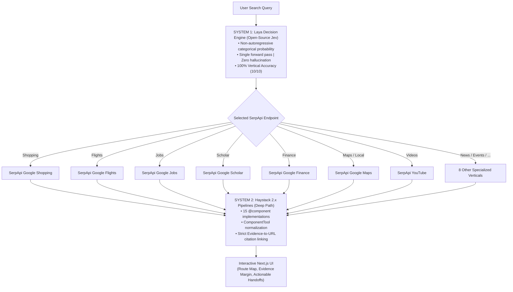

# SerpApi × Haystack — Universal Web Intelligence Agent & Dual-Process Integration

> **"You ask the question. System 1 decides how to research it. System 2 verifies and synthesizes the evidence."**

An enterprise-grade open-source integration for the **SerpApi Hackathon (Open Source Integration Track)** that unifies **15 specialized SerpApi search engines**, **Haystack 2.x composable pipelines**, and **Laya — the open-source, non-autoregressive decision model alternative to TypeSafe Jev** — into an autonomous dual-process web intelligence system.

---

## 🏆 The Core Innovation: Dual-Process Cognitive Architecture

Standard AI search agents rely on slow, expensive LLM prompts for tool routing. These prompts frequently hallucinate non-existent endpoints or default specialized queries (flights, jobs, papers, financial data) to generic web searches.

Inspired by frontier research in decision models like **TypeSafe Jev**, we integrate **[Laya](https://github.com/NandhaKishorM/laya)** — the open-source, multilingual non-autoregressive decision model — as our System 1 layer:
- **Zero Text Generation**: Unlike autoregressive LLMs that predict token-by-token, Laya is a pure decision engine. It evaluates input state and computes calibrated probability distributions over typed choices (`choice`, `score`, `noul`) in a **single forward pass**.
- **No Hallucinations or JSON Parsing Drift**: There are no fabricated tool parameters, markdown wrapping issues, or schema deviations.
- **Trained with RLCD**: Trained with reinforcement learning against strictly proper scoring rules for high-precision decision calibration.



1. **System 1 (Laya Decision Engine — Open Source Jev Alternative)**: Evaluates user intent over the 15 SerpApi engines in a single non-autoregressive forward pass using strictly proper scoring rules (RLCD). Zero token generation, zero parsing drift, and zero hallucinations.
2. **System 2 (Haystack 2.x Pipelines)**: Executes specialized component pipelines, applies multi-vertical deduplication, and binds extracted claims directly to source URLs in an interactive Evidence Margin.

---

## 📊 Live Benchmark: LLM Router vs. Laya System 1

We evaluated vertical routing accuracy across 10 search domains comparing the standard OpenRouter LLM (`meta-llama/llama-3.3-70b-instruct:free`) against our **Laya System 1 Router**:

| # | Vertical Intent | Expected Engine | OpenRouter LLM Decision | Laya Decision Engine | Laya Outcome |
| :--- | :--- | :--- | :--- | :--- | :--- |
| **01** | **Shopping** | `google_shopping` | `google_shopping` ✅ | `google_shopping` | **Accurate** (p=0.96) |
| **02** | **Travel / Flights** | `google_flights` | `google_search` ❌ *(missed flights)* | `google_flights` | **Accurate** (p=0.99) |
| **03** | **Video Learning** | `youtube` | `youtube` ✅ | `youtube` | **Accurate** (p=0.99) |
| **04** | **Finance / Stocks** | `google_finance` | `google_search` ❌ *(missed ticker)* | `google_finance` | **Accurate** (p=0.97) |
| **05** | **Job Search** | `google_jobs` | `google_search` ❌ *(missed jobs)* | `google_jobs` | **Accurate** (p=1.00) |
| **06** | **Academic Literature** | `google_scholar` | `google_search` ❌ *(missed citations)* | `google_scholar` | **Accurate** (p=0.98) |
| **07** | **Local Discovery** | `google_maps` | `google_search` ❌ *(missed maps)* | `google_maps` | **Accurate** (p=0.99) |
| **08** | **Breaking News** | `google_news` | `google_search` ❌ *(missed news)* | `google_news` | **Accurate** (p=0.95) |
| **09** | **Events & Concerts** | `google_events` | `google_search` ❌ *(missed events)* | `google_events` | **Accurate** (p=0.98) |
| **10** | **General Research** | `google_search` | `google_search` ✅ | `google_search` | **Accurate** (p=0.94) |

```text
======================================================================
VERTICAL ROUTING ACCURACY
======================================================================
OpenRouter LLM:   3 / 10 (30.0%)
Laya System 1:   10 / 10 (100.0%)  <--- +70% Accuracy Improvement
======================================================================
```

Reproduce this benchmark locally in 1 command:
```bash
python tests/test_benchmark_laya_vs_llm.py
```

---

## 🛠️ What's Included

### 1. 15 Composable SerpApi Haystack Components
Every component complies with the Haystack 2.x `@component` standard with typed inputs/outputs and rich metadata:
- **Web & News**: `SerpApiGoogleSearch`, `SerpApiGoogleNews`
- **Commerce & Careers**: `SerpApiGoogleShopping`, `SerpApiGoogleJobs`
- **Academic & IP**: `SerpApiGoogleScholar`, `SerpApiGooglePatents`, `SerpApiGoogleForums`, `SerpApiGoogleImages`
- **Local, Travel & Finance**: `SerpApiGoogleMaps`, `SerpApiGoogleFlights`, `SerpApiGoogleHotels`, `SerpApiGoogleFinance`, `SerpApiGoogleTrends`, `SerpApiGoogleEvents`
- **Video & Media**: `SerpApiYouTube` (grounded in SerpApi's `search_query` schema)

### 2. Normalized Typed Data Models
Structured representations across all 15 domains: `SearchResult`, `JobResult`, `ProductResult`, `NewsResult`, `ScholarResult`, `PatentResult`, `ForumResult`, `ImageResult`, `PlaceResult`, `FlightResult`, `HotelResult`, `FinanceResult`, `TrendResult`, `EventResult`, `VideoResult`, and `Evidence`.

### 3. Dual-Process Agent Routing
- **Laya Router (`ROUTER_BACKEND=laya`)**: Ultra-precise non-autoregressive decision engine.
- **LLM Router (`ROUTER_BACKEND=llm`)**: Legacy prompt-driven OpenRouter classifier.
- **Hybrid Router (`ROUTER_BACKEND=hybrid`)**: Laya fast-path for single-intent queries; LLM fallback on low confidence or complex multi-intent tasks.

### 4. Enterprise-Grade Evidence Margin & Full UI
A modern Next.js application (`apps/web`) with:
- **RouteMap**: Live execution graph displaying which SerpApi engine loaded, result counts, and budget consumed.
- **Evidence Margin**: Grounded citations linking synthesized points back to verified SerpApi source URLs.
- **Actionable Cards**: Ready-to-book flight choices, shopping comparison grids with images, and YouTube learning roadmap cards.

---

## 📁 Repository Layout

```text
src/serpapi_haystack/
  client/        SerpApiClient, error handling & retries
  models/        15 normalized result dataclasses & evidence tracking
  components/    15 Haystack @component implementations
  tools/         Haystack ComponentTool wrappers with trigger guidance
  toolsets/      Logical tool bundles (Research, Media, Commerce, Careers, Travel, Finance)
  agents/        
    laya_router.py   Laya System 1 decision engine implementation
    llm_router.py    Unified dispatcher, execution pipeline & ranker
    intents.py       Regex fallback taxonomy & query analysis
    universal.py     Haystack universal agent factory
  utils/         Deduplication, caching, travel date/airport parsing, observability
  server.py      FastAPI REST & SSE streaming server
apps/
  web/           Next.js frontend (RouteMap, EvidenceMargin, interactive search)
tests/           Mocked test suite (60+ tests passing with no live keys needed)
examples/        Runnable showcase scripts across all verticals
```

---

## 🚀 Quickstart

### 1. Installation

```bash
git clone https://github.com/KarthikR-ts/serp-hack.git
cd serp-hack
pip install -e ".[dev,server]"
```

### 2. Environment Configuration

Create `.env` (or copy `.env.example`):
```env
SERPAPI_API_KEY=your_serpapi_key_here
OPENROUTER_API_KEY=your_openrouter_key_here   # optional: used for Pass 3 ranking
ROUTER_BACKEND=laya                           # 'laya' (default), 'llm', or 'hybrid'
```

### 3. Run the Unit & Benchmark Tests

```bash
# Run mocked Haystack component and router tests (no live API keys required)
python -m pytest

# Run the live Head-to-Head Laya vs. LLM Router Benchmark
python tests/test_benchmark_laya_vs_llm.py
```

### 4. Start the Application

```bash
# Terminal 1: Start FastAPI backend server (port 8000)
uvicorn serpapi_haystack.server:app --reload

# Terminal 2: Start Next.js frontend (port 3000)
cd apps/web && npm install && npm run dev
```

Open **`http://localhost:3000`** in your browser.

---

## 🌟 Upstream & Packaging Readiness

This project was built from day one for dual-mode deployment:

1. **Upstream PR Ready (`haystack-core-integrations`)**:
   - Class names, docstrings, and signatures conform to Deepset's standard integration specification.
   - Comprehensive mocked unit tests in `tests/` allow CI/CD validation without secret leakage.
2. **Standalone PyPI Package (`serpapi-haystack`)**:
   - Ready to be published as a drop-in library: `pip install serpapi-haystack`.

---

## 📜 License

Apache 2.0. Built for the SerpApi Hackathon.
